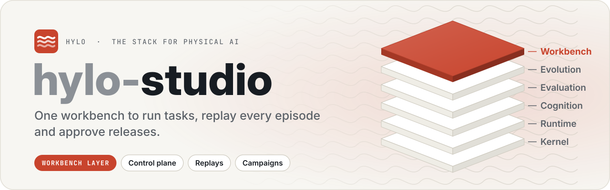
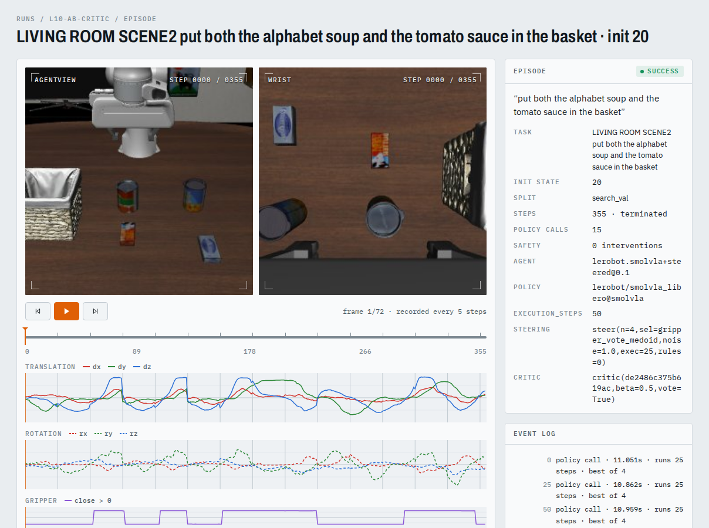
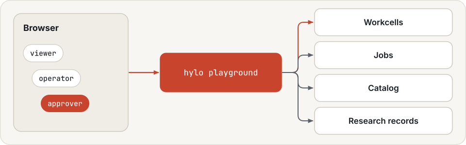
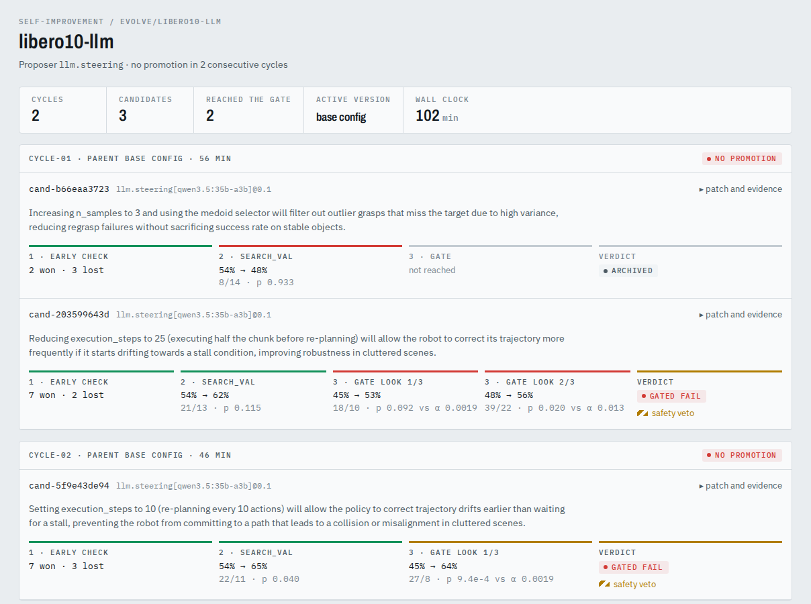
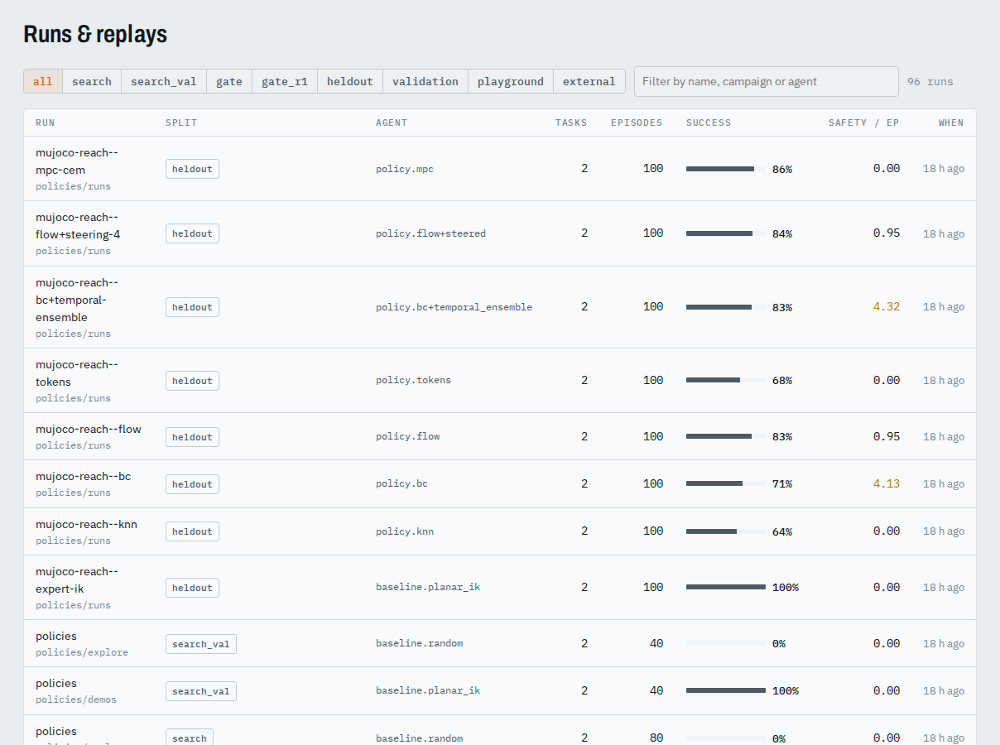
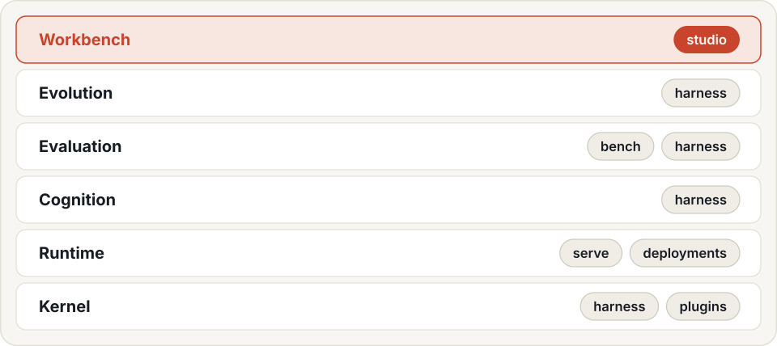

<p align="center">
  <picture>
    <source media="(prefers-color-scheme: dark)" srcset=".github/assets/banner-dark.svg">
    
  </picture>
</p>

<p align="center">
  <a href="LICENSE"></a>
  
  
  
  
</p>

<p align="center">
  <a href="https://hyloai.github.io/"><b>Website</b></a> ·
  <a href="https://hyloai.github.io/hylo-docs/"><b>Docs</b></a> ·
  <a href="https://hyloai.github.io/hylo-docs/getting-started/quickstart/"><b>Quickstart</b></a> ·
  <a href="https://github.com/HyloAI"><b>All repositories</b></a>
</p>

Part of [Hylo](https://hyloai.github.io/), the stack for physical AI. This repository is **Hylo Studio**, the
**workbench** layer.

The playground: one web UI over runs, campaigns, learning artifacts and workcells. `packages/hylo-playground` is the
FastAPI backend and control plane (`hylo playground`); `web/` is the React front end, built into the package.

<p align="center">
  
</p>
<p align="center">Replaying one LIBERO-10 episode: both cameras, the action traces and every policy call.</p>

The control plane never sends actions. It starts episodes on workcells (the workcell API, hylo.workcell/v0.1),
relays operator input with roles (viewer < operator < approver; the e-stop is open to every role) and runs `hylo`
commands as jobs. It reads runs and campaigns through the harness's catalog.

<p align="center">
  <picture>
    <source media="(prefers-color-scheme: dark)" srcset=".github/assets/control-plane-dark.svg">
    
  </picture>
</p>

<table>
  <tr>
    <td width="50%"></td>
    <td width="50%"></td>
  </tr>
  <tr>
    <td align="center">A campaign and the gate's verdicts</td>
    <td align="center">Runs and replays</td>
  </tr>
</table>

```bash
cd web && npm install --ignore-scripts && npm run build && cd ..
uv run hylo playground --repo ../bench \
  --workcell sim-arm=http://127.0.0.1:8102 --policy wave=ws://127.0.0.1:8002/hylo       # http://127.0.0.1:8765
```

`--repo` is the working directory the UI shows (`examples/configs`, `examples/evolve`, `runs/`) and runs jobs in.
Pages and options: [web/README.md](web/README.md).

Documentation (hylo-docs, `uv run mkdocs serve -f docs/mkdocs.yml` from the workspace): [studio](../docs/docs/user-guide/studio.md).

## The Hylo stack

<p align="center">
  <picture>
    <source media="(prefers-color-scheme: dark)" srcset=".github/assets/stack-dark.svg">
    
  </picture>
</p>

## License

Apache License 2.0 (see [LICENSE](LICENSE)). Copyright 2026 Hylo AI.
